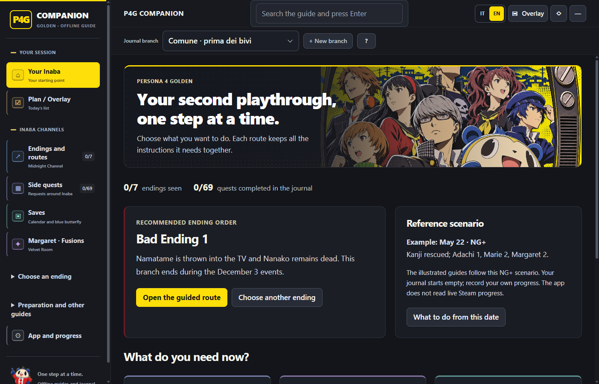
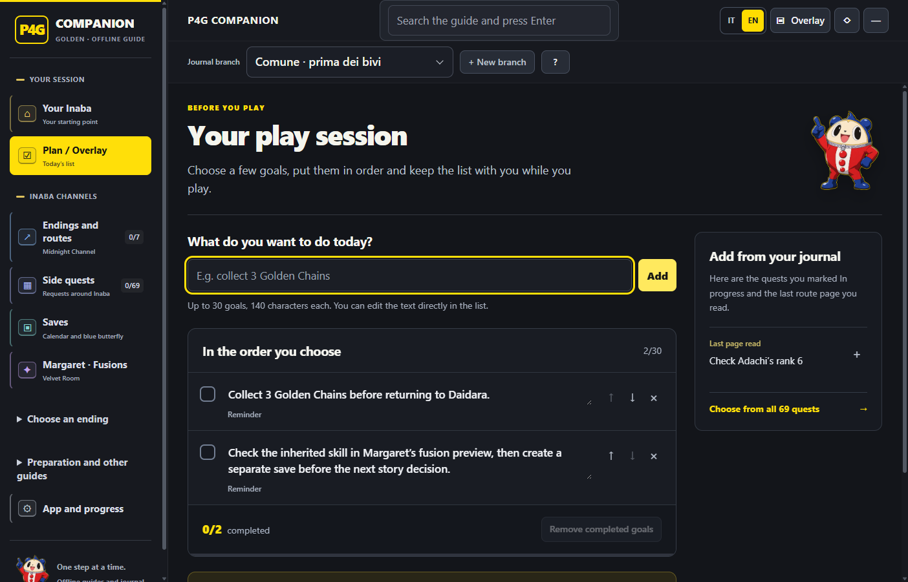
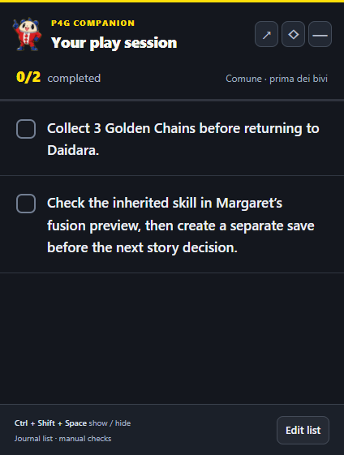

# P4G Companion

[English](README.md) · [Download](https://github.com/EdoXBroS12/P4G-Companion/releases) · [Segnala un problema](https://github.com/EdoXBroS12/P4G-Companion/issues)

Un’app Windows offline per **Persona 4 Golden**: segui i percorsi dei finali, registra le quest e prepara le richieste di fusione di Margaret. Scegli gli obiettivi prima di giocare e tieni accanto al gioco una piccola lista sempre in primo piano. L’interfaccia e le guide testuali sono disponibili in italiano e inglese.

**Spoiler integrali della storia.** È un progetto indipendente realizzato da fan, senza affiliazione o approvazione di ATLUS o SEGA. Versione **1.3.0**.

La versione 1.3.0 aggiunge il piano della sessione, un overlay dedicato alla lista e una navigazione più chiara, con grafica gialla e nera ispirata alle TV di Persona 4. I contenuti della guida di gioco restano quelli della versione 1.2.0.



## Scaricare e avviare

1. Apri [Releases](https://github.com/EdoXBroS12/P4G-Companion/releases) e scarica l’`.exe` portabile Windows x64 allegato alla versione desiderata.
2. Avvia il file scaricato. Non serve installare separatamente Node.js o Python. Il primo avvio può richiedere qualche secondo per l’estrazione temporanea del programma.
3. Scegli la lingua con **IT / EN** nell’intestazione. Apri **Piano / Overlay** per preparare la sessione oppure scegli un finale, il catalogo quest o la guida di Margaret.

Se non è ancora disponibile una release, usa le istruzioni di compilazione qui sotto. Gli archivi **Source code** di GitHub contengono il progetto, non un’app già pronta da avviare.

L’eseguibile attualmente non ha una firma digitale dell’editore. Windows SmartScreen o Smart App Control possono mostrare un avviso o bloccarlo in base alle impostazioni di sicurezza del sistema.

## Contenuti

- Sette esiti pratici: Bad 1, Bad 2, Bad 3, Complice, Normal/Good, True e Golden. Alcune guide raggruppano diversamente le varianti negative; Golden aggiunge contenuti alla conclusione True.
- Istruzioni, risposte originali inglesi, checkpoint e roadmap generale.
- Tutte le **69 quest**, con obiettivi, prerequisiti, luoghi, ricompense e note che distinguono disponibilità, scadenze e termini prudenti.
- Preparazione, Social Link, libri, pesca e altri contenuti mancabili.
- Nove richieste di Margaret, ricette guidate, Skill Card e calcolatore con livelli attuali delle Persona modificabili.
- Lista della sessione con promemoria personali, quest selezionate e singoli passi dei percorsi, più un overlay essenziale accompagnato da Teddie.
- Rami separati del diario per lista della sessione, quest, checklist, appunti e livelli delle fusioni; storico comune dei finali già visti.
- Schede illustrate, PDF e dossier delle fonti locali.

**Copertura delle lingue:** il cambio lingua traduce l’interfaccia e le guide testuali. Le schede illustrate, i PNG e i PDF attualmente inclusi restano in **italiano**. Nomi e dialoghi originali inglesi del gioco sono mantenuti per riconoscere le opzioni. Le spiegazioni italiane sono traduzioni redazionali, non una dichiarazione di corrispondenza alla localizzazione ufficiale.

La barra laterale distingue **La tua sessione** dai **Canali di Inaba**: finali, quest, salvataggi e Margaret. Preparazione, Social Link, attività e fonti sono raccolti in **Preparazione e altre guide**.

## Preparare la sessione

1. Seleziona il ramo del diario corrispondente al salvataggio del gioco, poi apri **Piano / Overlay**.
2. Scrivi un promemoria, aggiungi una quest dalla sua scheda oppure usa **Aggiungi questo passo alla sessione** mentre leggi un percorso. Nei suggerimenti compaiono anche le quest segnate **In corso** e l’ultima pagina del percorso consultata.
3. Inserisci fino a **30 obiettivi**, ciascuno di massimo **140 caratteri**. Modifica il testo nella lista, cambia l’ordine con le frecce o rimuovi una voce. Puoi aggiungere separatamente più passi dello stesso finale.
4. Quando sei pronto, scegli **Apri lista in overlay**. Spunta gli obiettivi svolti e usa il pulsante guida di una voce collegata per riaprire la quest o il passo del percorso.
5. Torna in **Piano / Overlay** per modificare la lista o rimuovere gli obiettivi completati.

La lista viene salvata nel ramo del diario selezionato. Le sue caselle registrano soltanto gli obiettivi della sessione: non completano automaticamente quest o finali. Confermali separatamente nel gioco e nel diario. Promemoria personali e nomi dei rami mantengono il testo originale quando cambi lingua.



## Durante il gameplay

Il pulsante **Overlay** trasforma l’app in una piccola finestra con la lista della sessione, il conteggio degli obiettivi completati e i collegamenti alle guide. Puoi spostarla e ridimensionarla dalla normale cornice Windows. Torna all’app completa per modificare la lista o leggere una guida.

È una finestra desktop separata, senza iniezione nel processo del gioco. Usa la modalità finestra o finestra senza bordi: il fullscreen esclusivo può coprire le finestre del desktop.

| Scorciatoia | Azione |
|---|---|
| `Ctrl + Shift + Spazio` | Mostra o nasconde il pannello |
| `Ctrl + Shift + O` | Passa fra lista in overlay e app completa |
| `Ctrl + Shift + T` | Attiva o disattiva il primo piano |
| `Ctrl + Shift + I` | Nell’overlay, alterna clic sulla lista e passaggio dei clic al gioco |

**Modalità passiva:** i clic attraversano l’overlay e raggiungono il gioco. Premi di nuovo **Ctrl + Shift + I** per interagire con la lista. La modalità passiva si attiva soltanto nell’overlay e quando questa scorciatoia di recupero è disponibile; se è occupata da un altro programma, l’app mantiene attivi i clic sulla lista.

Nelle impostazioni puoi regolare testo e opacità. I menu con ricerca funzionano anche da tastiera. I controlli dell’overlay permettono di tornare all’app, cambiare modalità dei clic o nascondere la finestra.



## Diario e rami di salvataggio

La guida inclusa usa una partita di esempio in New Game+ dal **22 maggio**, con ranghi Social Link e slot numerati di riferimento. Frasi come «dal tuo 22 maggio» descrivono quello scenario: **non sono una lettura in tempo reale della tua partita**. Verifica data, ranghi e slot effettivi prima di seguirne il calendario. La guida non include l'importazione di un salvataggio del gioco o del diario personale di un giocatore.

Il diario è un registro manuale: non legge, modifica o sincronizza i salvataggi del gioco. Segna una quest completata soltanto dopo aver controllato il registro del gioco.

Crea un ramo del diario quando separi i salvataggi nella partita. Il nuovo ramo copia il diario attualmente selezionato, inclusa la lista della sessione; le modifiche successive restano nel rispettivo ramo. Non ricostruisce un checkpoint precedente. Ricaricare un vecchio salvataggio non unisce quest, inventario o progressi delle Persona con quelli di un altro salvataggio. Seleziona il ramo corrispondente e verifica i livelli attuali prima di calcolare fusioni triangolari.

I progressi vengono conservati nella cartella dati dell’utente Windows. Puoi aprirla dalle impostazioni oppure esportare e importare il diario in JSON. L’EXE portabile e il diario sono file separati: una copia esportata è utile per passare a un altro PC.

Guide, immagini e calcolatore funzionano offline. I collegamenti alle fonti web aprono il browser e richiedono una connessione.

## Verifica e limiti

I contenuti sono stati confrontati con guide specifiche di Golden, dossier delle fonti e test degli algoritmi. Questo non garantisce che ogni percorso, variante di dialogo o fusione sia stato provato direttamente nel gioco. Consulta le fonti incluse e segnala eventuali discrepanze indicando data, luogo e testo esatto del messaggio.

Le fusioni dipendono dai livelli impostati e dai dati Golden utilizzati. Una combinazione che produce una Persona non dimostra che gli ingredienti possiedano l’abilità richiesta o siano disponibili nel tuo salvataggio. Controlla risultato e abilità ereditata nell’anteprima prima di confermare. Il calcolatore non enumera tutte le catene di eredità, gli incidenti o gli effetti delle previsioni di fusione.

## Compilare dai sorgenti

Usa **Windows x64 e Node.js 24**. Dalla cartella principale del repository, che contiene `package.json`, `main.cjs`, `src/` e `content/`, esegui:

```powershell
npm ci
node node_modules/electron/install.js
npm test
npm run build
```

L’app portabile viene generata in `dist/`. Per lo sviluppo locale:

```powershell
npm start
```

L’installazione delle dipendenze e la prima compilazione richiedono Internet. Il workflow GitHub Actions esegue i test, compila l’EXE Windows e carica un artefatto con checksum. **Non** pubblica una GitHub Release: la pubblicazione è un passaggio separato del manutentore.

Per correzioni, traduzioni e test dell’interfaccia con profili isolati, consulta [CONTRIBUTING.md](CONTRIBUTING.md).

## Licenze e crediti

Il codice dell’app è disponibile con **licenza MIT**; il testo è nel file `LICENSE` del repository. La licenza non concede diritti sui personaggi di Persona, sui dialoghi del gioco, sui marchi o sulle illustrazioni.

Logica e dati di fusione incorporano il lavoro di [aqiu384/megaten-fusion-tool](https://github.com/aqiu384/megaten-fusion-tool), distribuito dal progetto originale con **Unlicense**. [THIRD_PARTY_NOTICES.md](THIRD_PARTY_NOTICES.md) riporta attribuzione, revisione utilizzata e distinzione fra codice, illustrazioni fan art e materiali del gioco.
