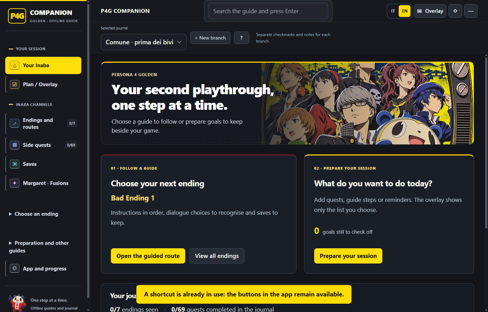
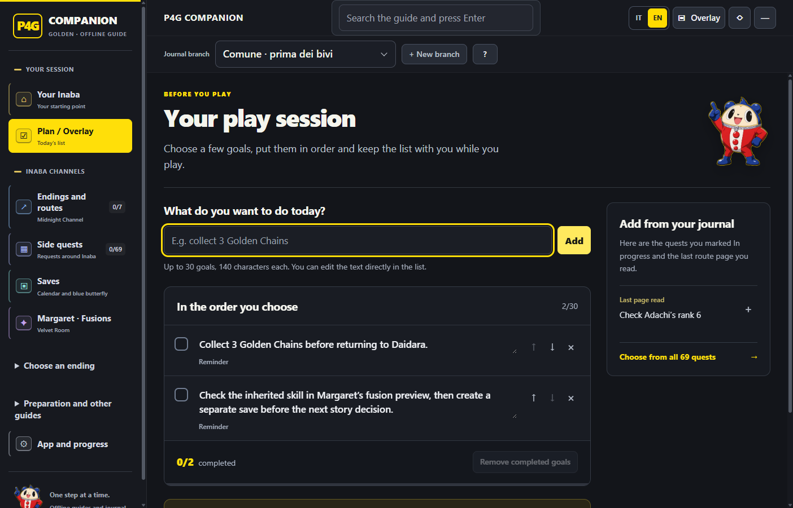
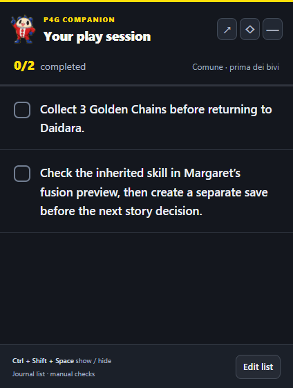

# P4G Companion

[Italiano](README.it.md) · [Downloads](https://github.com/EdoXBroS12/P4G-Companion/releases) · [Report an issue](https://github.com/EdoXBroS12/P4G-Companion/issues)

An offline Windows companion for **Persona 4 Golden**: follow ending routes, track side quests and prepare Margaret’s fusion requests. Choose your goals before playing, then keep a small, always-on-top checklist beside the game. The interface and textual guides are available in Italian and English.

**Full story spoilers.** This is an independent fan project, with no affiliation with or endorsement by ATLUS or SEGA. Version **1.4.0**.

Version 1.4.0 adds a session planner, a dedicated checklist overlay and clearer navigation in a yellow-and-black TV-inspired interface. The gameplay guide content is unchanged from 1.2.0.



## What changed in 1.4

- A simpler home screen with two main actions: follow a guide or prepare your session.
- Quests in pages of 12; search still covers all 69 quests.
- Save checkpoints grouped by phase, with expandable instructions.
- Separate appearance, overlay and journal-backup settings.
- A clearer branch dialog with a full-width name field, persistent action buttons and keyboard focus.

## Download and start

1. Open [Releases](https://github.com/EdoXBroS12/P4G-Companion/releases) and download the portable Windows x64 `.exe` attached to the release you want.
2. Run the downloaded file. No separate Node.js or Python installation is needed. The portable launcher may take a few seconds to extract its runtime on first launch.
3. Use **IT / EN** in the header to choose a language. Open **Plan / Overlay** to prepare your session, or select an ending, the quest catalogue or Margaret’s guide.

If a release has not been published yet, use the source-build instructions below. GitHub’s **Source code** archives contain the project, not a ready-to-run app.

The executable is currently unsigned. Windows SmartScreen or Smart App Control may warn about or block it according to your system’s security settings.

## What is included

- Seven practical ending routes: Bad 1, Bad 2, Bad 3, Accomplice, Normal/Good, True and Golden. Some guides group the bad-ending variants differently; Golden extends the True conclusion with additional content.
- Instructions, original English dialogue choices, checkpoint reminders and a master roadmap.
- All **69 side quests**, with objectives, prerequisites, locations, rewards and notes distinguishing availability from deadlines or precautionary target dates.
- Preparation, Social Links, books, fishing and other missable content.
- Margaret’s nine requests, guided fusion recipes, Skill Cards and a calculator with adjustable current Persona levels.
- A session list with manual reminders, selected quests and individual steps from ending routes, plus a focused overlay with Teddie.
- Separate journal branches for session lists, quest states, checklists, notes and fusion levels; shared history of endings you have seen.
- Local illustrated cards, PDFs and source notes.

**Language coverage:** the language switch translates the interface and textual guides. The currently bundled illustrated cards, PNGs and PDFs remain in **Italian**. In-game English names and quoted dialogue are retained so that you can identify the correct prompts. Italian explanations are editorial translations, not a claim to reproduce an official localisation.

The sidebar groups **Your session** separately from **Inaba channels**: endings, quests, saves and Margaret. Preparation, Social Links, activities and sources remain together under **Preparation and other guides**.

## Prepare your session

1. Select the journal branch that matches your game save, then open **Plan / Overlay**.
2. Write a reminder, add a quest from its detail page, or use **Add this step to your session** while reading an ending route. Suggestions also show quests you marked **In progress** and your last route page.
3. Keep up to **30 goals**, each up to **140 characters**. Edit the text in the list, use the arrows to change the order, or remove an item. Different steps of the same ending can be added separately.
4. Choose **Open the list in overlay** when you are ready to play. Check goals as you finish them, and use a linked item’s guide button to reopen its quest or route step.
5. Return to **Plan / Overlay** to adjust the list or remove completed goals.

The list is saved in the selected journal branch. Its checkboxes only track your session goals: they do not automatically complete a quest or mark an ending as seen. Confirm those separately in the game and the journal. Your written goals and branch names keep their original wording when you switch languages.



## Use it while playing

The **Overlay** button switches the app to a small window showing your session list, its completion count and guide links. Resize or move it using the normal Windows frame. Return to the full app to edit the list or read a guide.

This is a separate desktop window, with no injection into the game. Use windowed or borderless-windowed mode; exclusive fullscreen may cover desktop windows.

| Shortcut | Action |
|---|---|
| `Ctrl + Shift + Space` | Show or hide the companion |
| `Ctrl + Shift + O` | Switch between the checklist overlay and the full app |
| `Ctrl + Shift + T` | Toggle always-on-top |
| `Ctrl + Shift + I` | In the overlay, toggle mouse interaction / pass clicks through to the game |

**Passive mode:** clicks pass through the overlay to the game. Press **Ctrl + Shift + I** again to interact with the checklist. Passive mode is only enabled in the overlay when this recovery shortcut is available; if another program occupies the shortcut, the app keeps mouse interaction enabled.

Text size and opacity are adjustable in settings. Searchable dropdowns support the keyboard as well as the mouse. The overlay’s controls let you return to the app, switch mouse interaction or hide the window.



## Progress and save branches

The bundled guide uses an example New Game+ run starting on **22 May**, with sample Social Link ranks and numbered save slots. References such as “your 22 May position” describe that guide scenario; they are **not a live reading of your game**. Check your own date, ranks and save slots before following its schedule. The app does not import a player's game save or personal journal with the guide.

The journal is a manual record. It does not read, edit or synchronise the game’s save files. Mark a quest completed only after checking the in-game quest log.

Create a journal branch when you separate your in-game saves. A new branch copies the currently selected journal, including its session list; subsequent edits stay with that branch. It does not reconstruct an earlier checkpoint. Loading an old game save does not combine its quests, inventory or Persona progress with another save. Select the matching journal branch and check your current Persona levels before calculating triangular fusions.

Progress is stored in the Windows user’s application-data folder. Open that folder from the app’s settings, or export/import the journal as JSON. The portable EXE and the journal are separate files: keeping an exported copy is useful when moving to another PC.

The guides, images and calculator work offline. Opening a web source uses your browser and requires an internet connection.

## Verification and limitations

The content has been checked against Golden-specific guides, source notes and algorithm tests. This is not a guarantee that every route, dialogue variant or fusion has been tested inside the game. See the source notes included with the app, and report a discrepancy with its date, location and exact prompt.

Fusion results depend on the configured levels and the underlying Golden dataset. A recipe that creates a species does not prove that its ingredients possess the required skill or are available in your save. Check the fusion preview and the inherited skill before confirming. The calculator does not enumerate every possible inheritance history, accident or forecast effect.

## Build from source

Use **Windows x64 and Node.js 24**. Run these commands from the repository root, which contains `package.json`, `main.cjs`, `src/` and `content/`:

```powershell
npm ci
node node_modules/electron/install.js
npm test
npm run build
```

The portable app is generated under `dist/`. For local development:

```powershell
npm start
```

Dependency installation and the first packaging run need internet access. The GitHub Actions workflow runs the tests, builds the Windows executable and uploads a build artifact with checksums. It does **not** publish a GitHub Release; release publication is a separate maintainer step.

See [CONTRIBUTING.md](CONTRIBUTING.md) for content corrections, translation work and isolated UI testing.

## Licences and credits

Project application code is provided under the **MIT licence**; see `LICENSE` in the repository. This licence does not grant rights in Persona characters, game dialogue, trademarks or illustrations.

The fusion logic and data incorporate work from [aqiu384/megaten-fusion-tool](https://github.com/aqiu384/megaten-fusion-tool), whose upstream repository uses the **Unlicense**. Read [THIRD_PARTY_NOTICES.md](THIRD_PARTY_NOTICES.md) for attribution, the pinned source revision and the separate treatment of fan illustrations and game material.
